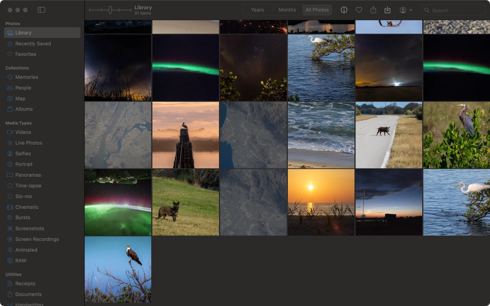
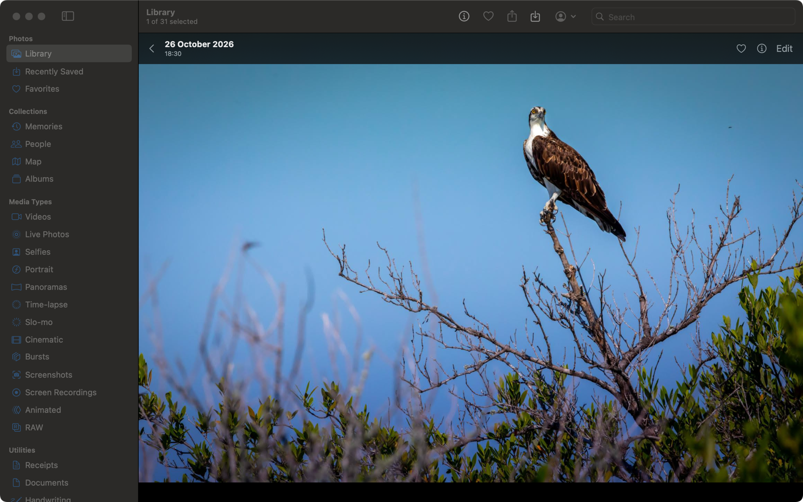
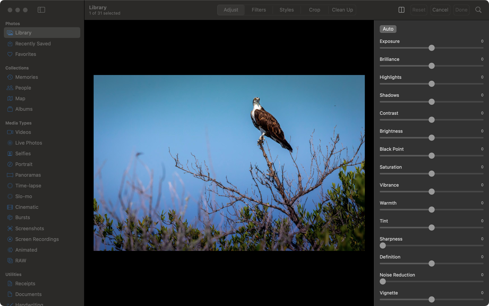
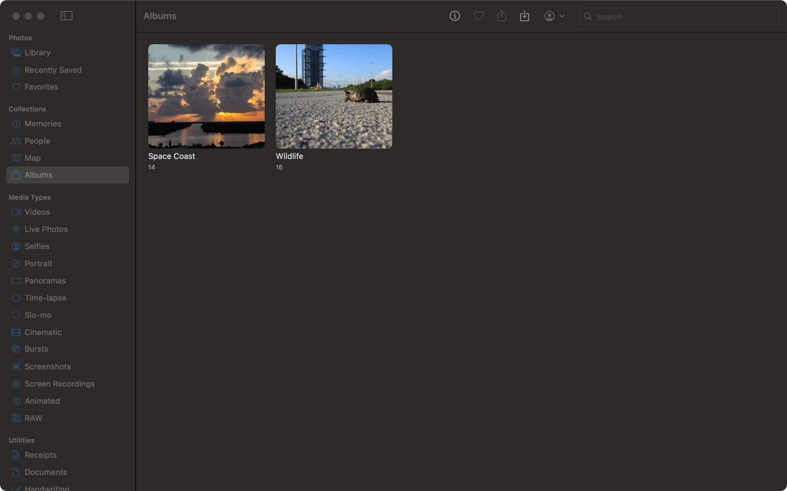

# HomeRoll Desktop

**A native Mac photos app for your own [Immich](https://immich.app) server – the look and feel of Photos for Mac, without iCloud.**

HomeRoll Desktop is the Mac sibling of [HomeRoll](https://github.com/silentprovider423/HomeRoll) (iPhone). It is an independent macOS client for a self-hosted Immich server: sidebar, grid with zoom levels, viewer, info window, editor, memories, map and smart albums, all working directly on your server. Edits use the same engine as HomeRoll on the iPhone, so a photo edited on the Mac looks the same on the phone.

> **Status:** works and is used daily against Immich v3.3.x with ~85,000 photos and videos. UI in English. Code comments are in German.
>
> Built with help from [Claude Code](https://claude.com/claude-code): Apple's Photos app for Mac was analysed with [rea](https://github.com/morluto/rea) (menus, shortcuts, edit tools), the design decisions and testing are mine, a lot of the Swift was written together with it.
>
> **Personal project:** no guarantees, no support promises. Bug reports and pull requests are welcome, I answer when I have time.
>
> Not affiliated with Apple or with Immich/FUTO. "Immich" is a trademark of its owners.

<p align="center">
  
  
</p>
<p align="center">
  
  
</p>
<p align="center"><sub>Screenshots with public-domain sample photos (NASA/Kennedy Space Center).</sub></p>

## Features

**Library**
- Sidebar like Photos: Library, Collections, media types, albums with their covers, people, memories, map, hidden, recently deleted
- Years · Months · All Photos, grid with five zoom levels and month headers, made for 80,000+ items
- Selection with click, ⇧, ⌘ and drag; context menus; drag photos into the Finder or drop files to import
- Info window (⌘I): caption, camera, place with map, people, albums, multi-selection
- Backup footer at the bottom of All Photos like Photos for Mac: number of photos and videos, progress of “Sync with Photos” with Pause (24 hours) / Resume, last backup time; click for details
- Short connection drops (Wi-Fi hiccup, waking from sleep, server restart) show “Offline” instead of an error and reload on their own when the server is back

**Viewer**
- Opens in the window (Space or double-click), ←/→ to browse, pinch and double-click to zoom
- Videos with the system player and a fallback for formats macOS can't play (Immich real-time transcoding)

**Editing** (same engine as HomeRoll on the iPhone)
- Adjust with 15 sliders + Auto, filters, photographic styles, crop/straighten/perspective with draggable corners
- Curves, levels and selective color; compare with the original (M); copy and paste edits to many photos (⇧⌘C / ⇧⌘V)
- Retouch brush (needs the optional Clean Up add-on)
- Edits are saved as a new version, stacked with the original on your server

**Organise**
- Albums: create, rename, delete, add and remove, **Make Key Photo** to set the cover; smart albums with rules (⌥⌘N)
- People: rename, favorite, merge, hide · Duplicates: review and merge
- Favorite, rotate, hide, delete and restore, shared links, print (⌘P)
- Export edited or original files; import files and folders (duplicates are skipped by checksum)
- Optional: take over new photos from Apple's Photos app on this Mac automatically

**Accounts**
- Several Immich accounts, switch any time; per account "view only" (no changes on the server) and "imports from this Mac"
- **Sign in with password or SSO/OIDC** ("Login with …"), also on servers with password login turned off (e.g. hosted Immich, Authentik, Keycloak)
- Menus and keyboard shortcuts like Photos for Mac

## Requirements

- An Immich server (tested with **v3.3.x**) reachable from the Mac – at home, via VPN or over https; login with password or SSO/OIDC
- macOS 15 Sequoia or newer (Apple silicon or Intel)

Optional server add-ons from the HomeRoll repo ([`server/`](https://github.com/silentprovider423/HomeRoll/tree/main/server)): Clean Up (retouch brush), relevance and categories services. The app works without them.

## Install

1. Download `HomeRoll-Desktop-<version>.zip` from the [latest release](https://github.com/silentprovider423/HomeRoll-Desk/releases/latest) and unzip it.
2. Move **HomeRoll Desktop.app** into your Applications folder.
3. The app is not notarized by Apple (it is a free hobby project without a paid developer account), so macOS blocks the first launch:
   open it once, click **Done**, then go to **System Settings → Privacy & Security**, scroll down and click **Open Anyway** next to "HomeRoll Desktop".
   Or in Terminal: `xattr -dr com.apple.quarantine "/Applications/HomeRoll Desktop.app"`
4. Log in with your Immich server address (e.g. `https://photos.example.com` or `http://192.168.x.y:2283`) and your Immich account.

Later versions install themselves: the app checks for updates at launch (or **HomeRoll Desktop → Check for Updates…**), downloads the new version, verifies it and restarts. No trip to GitHub and no **Open Anyway** again.

New to Immich? The [HomeRoll setup guide](https://github.com/silentprovider423/HomeRoll/blob/main/docs/SETUP.md) walks you through the server part.

## Build

```bash
brew install xcodegen
git clone https://github.com/silentprovider423/HomeRoll-Desk.git
cd HomeRoll-Desk
xcodegen generate
open HomeRollDesktop.xcodeproj
```

`./build-app.sh` builds the ad hoc signed app and packs it as a zip (it refuses to build if your user name or home path would end up in the app).

Debug builds can log in from the environment for testing (`FOTOS_SERVER`, `FOTOS_TOKEN`) and have a self-test that walks through the app and photographs its own window (`FOTOS_SELFTEST=<folder>`), see `Mac/SelfTest.swift`.

## Privacy

- The app talks **only** to your Immich server (and Apple Maps for maps). The one exception is the update check: at launch it asks GitHub for the newest version number of HomeRoll Desktop. Nothing about you or your photos is sent, and you can switch it off in Settings → Updates.
- No analytics, no third-party SDKs.
- The login token is stored in a file only your Mac user can read (`~/Library/Application Support/HomeRoll Desktop/`), never your password.
- SSO runs in Apple's sign-in sheet – the app never sees the password of your SSO provider.

## Project layout

```
Mac/       the macOS app (SwiftUI + AppKit)
Shared/    code shared with HomeRoll for iPhone (Immich API, models, edit engine) – kept in sync with that repo
Resources/ translations of the shared code
tools/     icon generator
```

## License

[GPL-3.0](LICENSE) (GNU General Public License v3.0; releases up to this change were published under MIT). Immich (AGPL-3.0) is not included – HomeRoll Desktop only talks to its HTTP API.

<!-- home-apps:start -->
## More Home apps

Same idea, other Apple apps – all free, open source and self-hosted:

- **[HomeRoll](https://github.com/silentprovider423/HomeRoll)** – Photos · Immich
- **[HomeRoll TV](https://github.com/silentprovider423/HomeRoll-TV)** – Photos for Apple TV · Immich
- **[HomeTune](https://github.com/silentprovider423/HomeTune)** – Music · Navidrome
- **[HomeNotes](https://github.com/silentprovider423/HomeNotes)** – Notes · Nextcloud
- **[HomePost](https://github.com/silentprovider423/HomePost)** – Mail · IMAP/SMTP or JMAP
- **[HomeFind](https://github.com/silentprovider423/HomeFind)** – Find My · Dawarich
- **[HomeCast](https://github.com/silentprovider423/HomeCast)** – Podcasts · PinePods
- **[HomeThread](https://github.com/silentprovider423/HomeThread)** – notes to self · own server (Docker)

All apps: [github.com/silentprovider423](https://github.com/silentprovider423)
<!-- home-apps:end -->
